# Stadium Tickets 3D

Compra de ingressos em 3D para um estádio fictício, numa noite de final. A experiência começa com a vista aérea do estádio; você escolhe o setor, a câmera desce até a arquibancada, você escolhe a cadeira e vê o campo exatamente de onde vai assistir ao jogo.

**Ver ao vivo:** https://guilhermeoliveirabrito.github.io/stadium-tickets-3d/

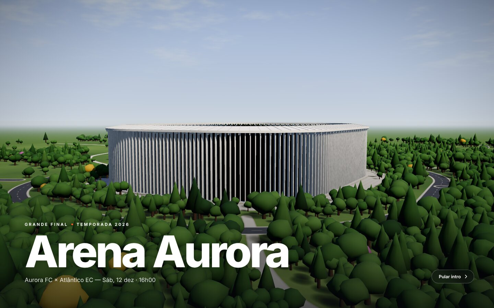

> Projeto de estudo. O estádio (Arena Aurora), os clubes (Aurora FC e Atlântico EC), a partida e a marca de ingressos (tribuna) são inventados.

## O que já tem

- Estádio gerado em código: três anéis de arquibancada, 130 blocos, cerca de 60 mil cadeiras, 24 camarotes, cobertura com treliças e fachada com brises
- Noite de jogo: refletores na cobertura, fachada e cobertura com faixas de LED animadas, céu estrelado com lua
- Gramado feito em shader, com faixas de corte e as marcações oficiais (105 x 68 m)
- Esplanada iluminada ligada ao estacionamento, uma via de acesso a partir da avenida e a cidade em volta, separada por jardins com palmeiras e um lago
- Bairros com casas, quintais, piscinas e prédios com janelas acesas, duas vilinhas perto do complexo e um skyline ao fundo
- Trânsito: carros na avenida e nos bairros, carros entrando no estacionamento pelas portarias, estacionando, desligando o motor, dando ré e indo embora, todos com faróis, lanternas e luz de freio
- Cerca de 3 mil pessoas andando em volta do estádio, chegando pelos portões, vindo do estacionamento e passeando pelas calçadas
- Abertura em duas partes: primeiro o texto (Minas Gerais · Brasil, os dois times, Arena Aurora) aparece sobre o fundo preto enquanto a cena carrega; depois o título desce para o canto e a câmera contorna o complexo, com fogos de artifício, até a vista aérea
- Dados da partida e painel de disponibilidade
- Escolha do setor: o bloco sob o cursor fica laranja, com número e preço; ao clicar, a câmera desce até a arquibancada e o painel mostra o preço, os lugares livres e o tipo de vista (meio-campo, lateral, diagonal, atrás do gol)
- Escolha da cadeira: a câmera fica de frente para o bloco, com as cadeiras livres em azul e as ocupadas em vermelho; a cadeira sob o cursor mostra fileira, número e preço, e a escolhida fica branca. De perto as cadeiras usam um modelo detalhado (concha moldada, encosto curvo e pé de metal)
- Camarotes VIP à venda: 24 camarotes com interior iluminado (poltronas de couro, bar, adega, TVs), preço do camarote inteiro e por pessoa, disponibilidade e vista própria
- Zoom na cadeira escolhida e a vista de quem senta nela: a câmera desce até os olhos do torcedor enquanto vira para o campo, e arrastar (mouse ou dedo) olha em volta
- Pagamento fictício (resumo, taxa, nome no ingresso e forma de pagamento) e o ingresso final, com a foto da vista do lugar, um mapa do estádio com o lugar marcado, portão, código do pedido e um código 2D ilustrativo; a compra solta os fogos de novo
- Painéis de LED na frente dos anéis e placas em volta do campo com o GitHub do autor
- Dois telões sobre a cobertura: placar com os dias até o jogo, a cadeira (ou o camarote) escolhida e, de vez em quando, o GitHub do autor
- Os dois times aquecendo no gramado, cada um com a sua bola (roda de passes, finalização contra o goleiro e tiros de corrida), bancos de reservas com a área técnica, rede nos gols e bandeirinhas de escanteio
- Um dirigível de propaganda com o GitHub do autor, que passa perto da câmera no começo da abertura e depois dá a volta no estádio, e um helicóptero com holofote varrendo o gramado
- Esc (ou o botão de voltar) retorna uma etapa

| Vista aérea | Estacionamento e avenida |
| --- | --- |
|  | 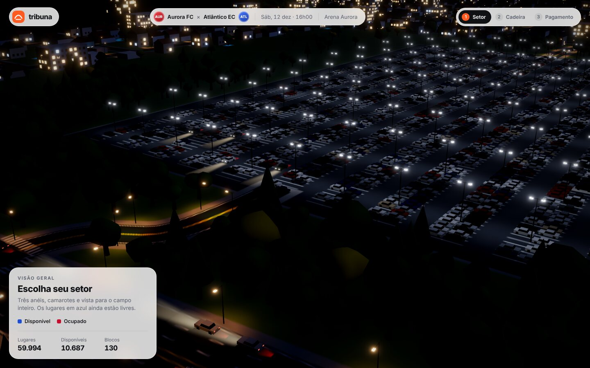 |

| Torcida na esplanada | Arquibancada norte |
| --- | --- |
| 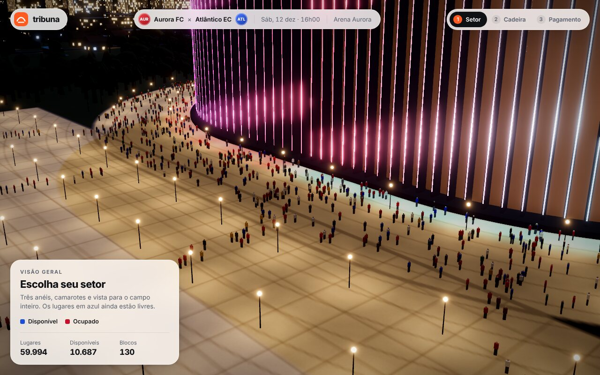 |  |

| Bloco em destaque na visão geral | Setor escolhido |
| --- | --- |
| 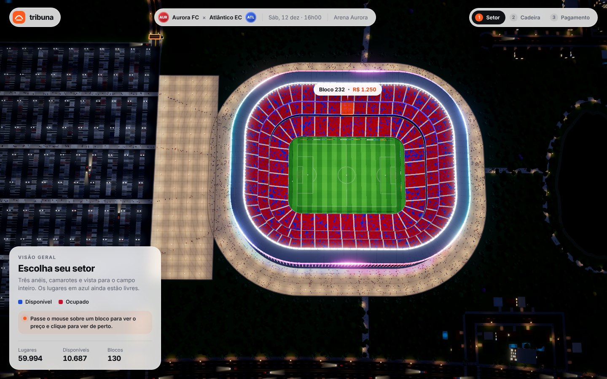 | 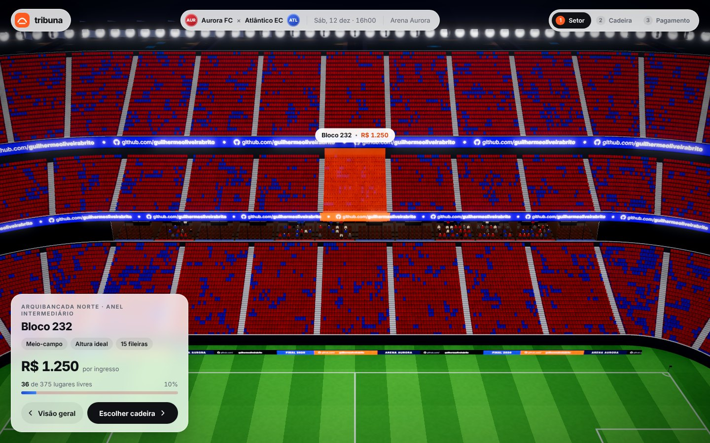 |

| Escolha da cadeira | Camarote VIP |
| --- | --- |
| 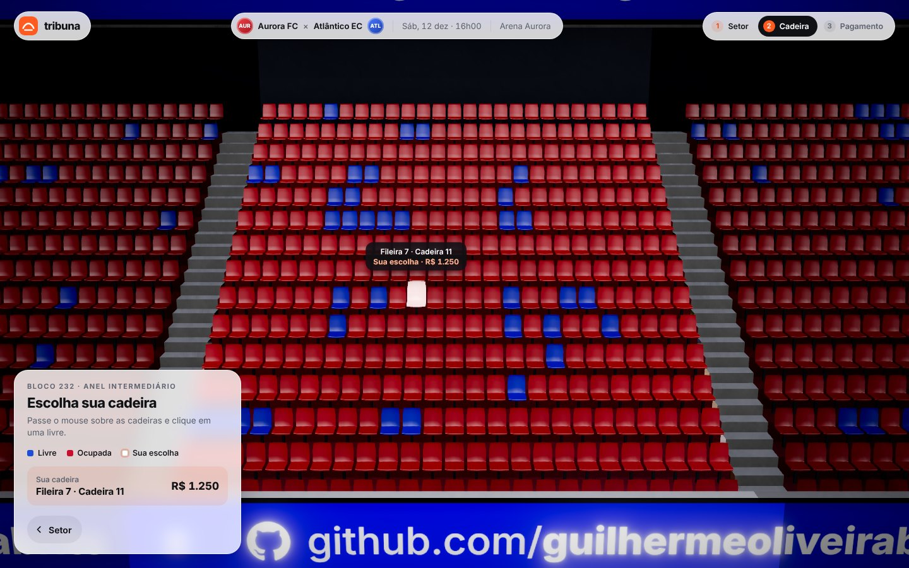 | 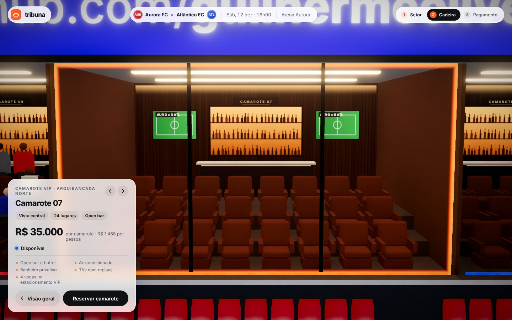 |

| Zoom na cadeira | Vista do lugar |
| --- | --- |
| 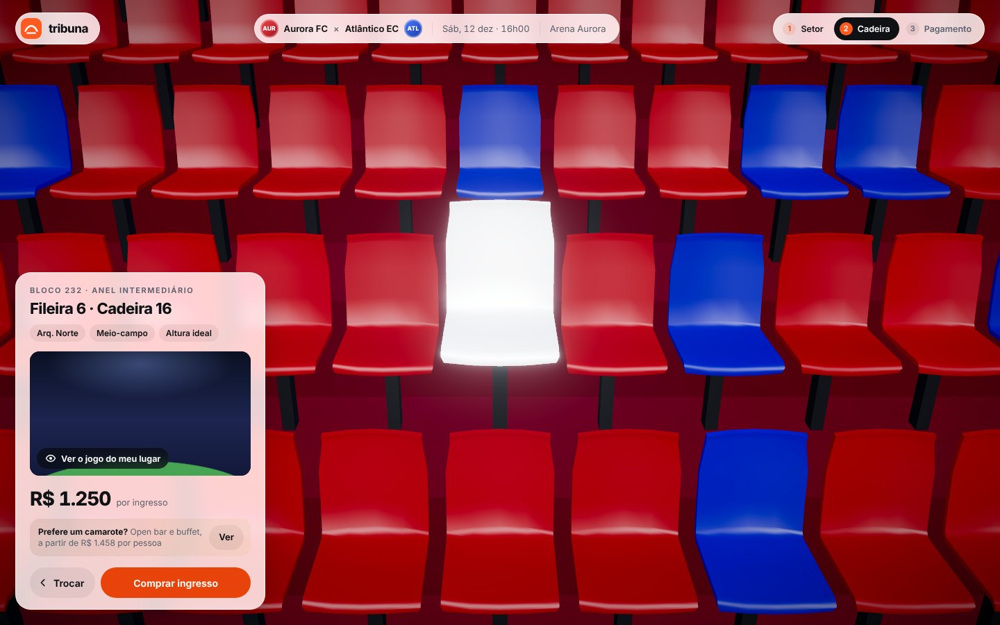 | 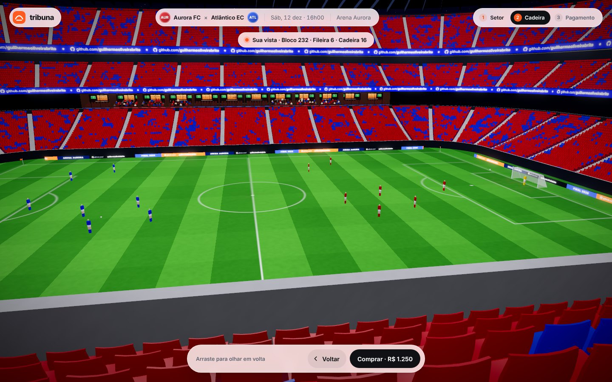 |

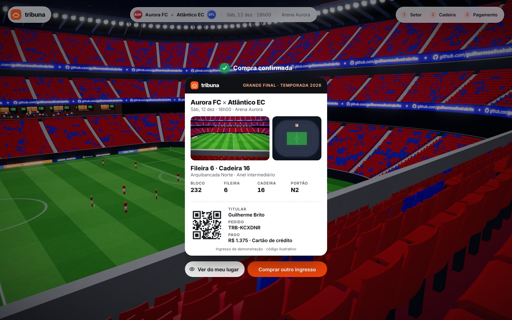

| Campo, jogadores e bancos | Telão e dirigível |
| --- | --- |
| 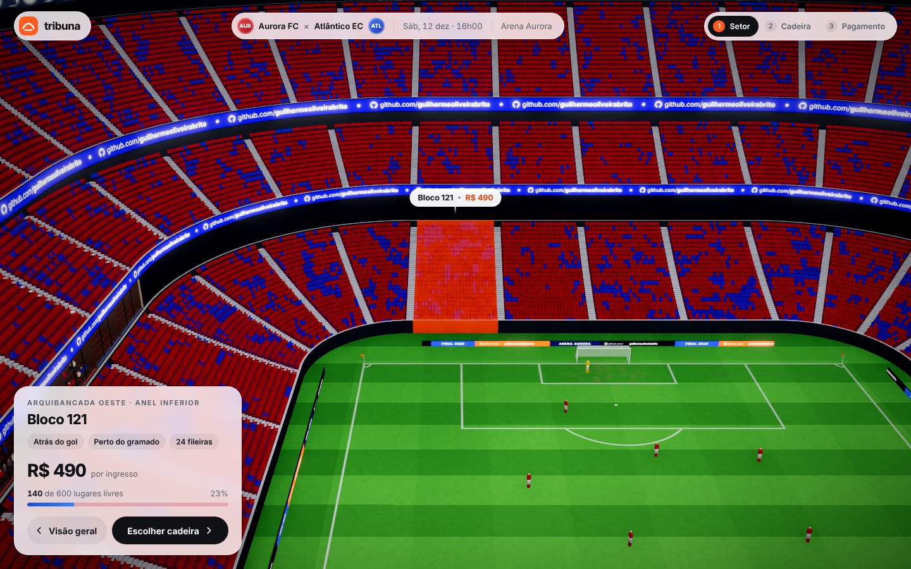 | 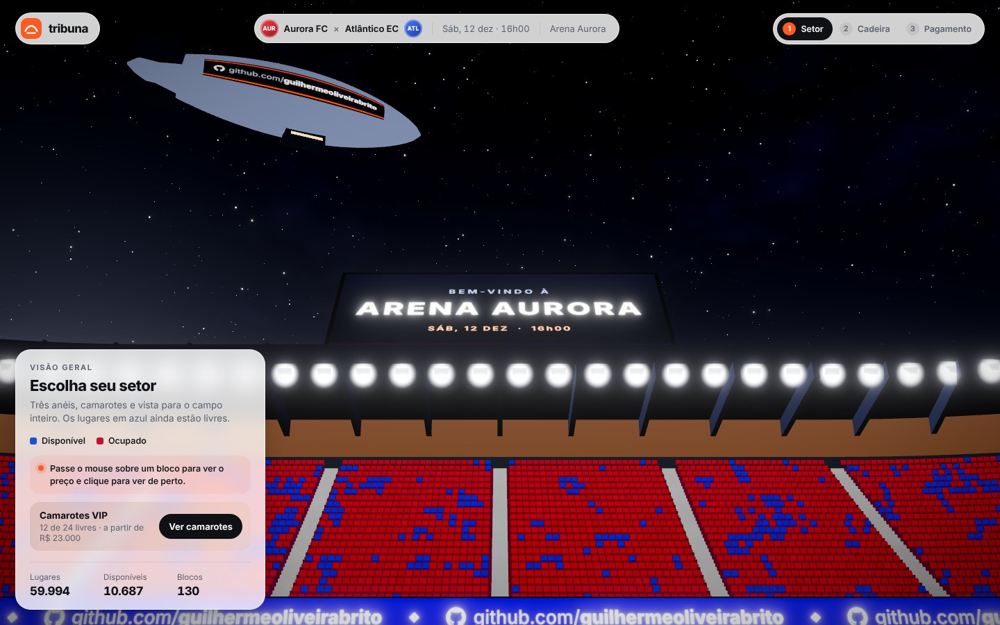 |

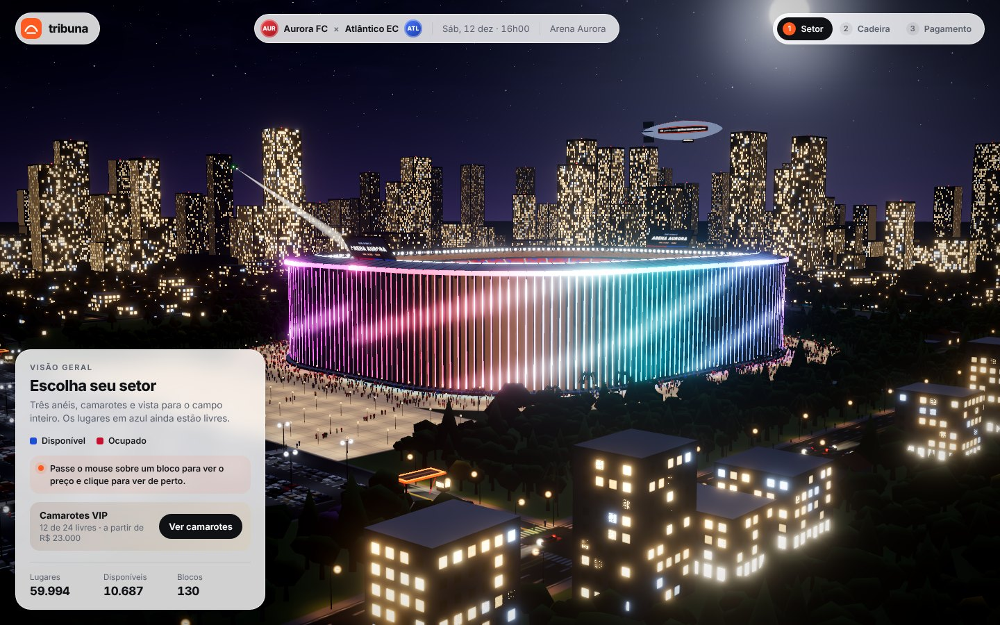

<p align="center">
  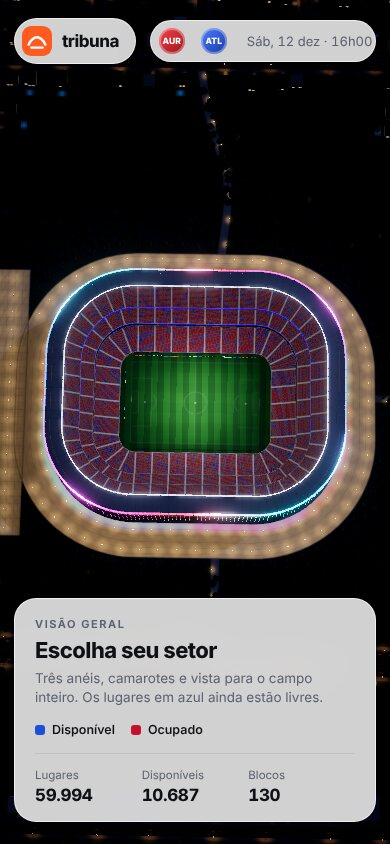
  &nbsp;
  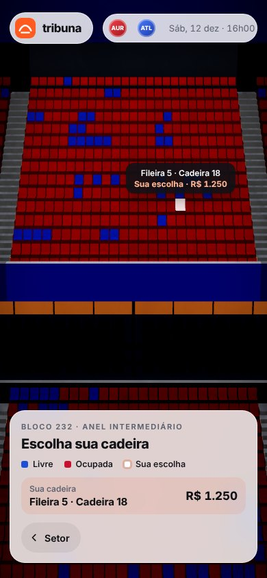
  &nbsp;
  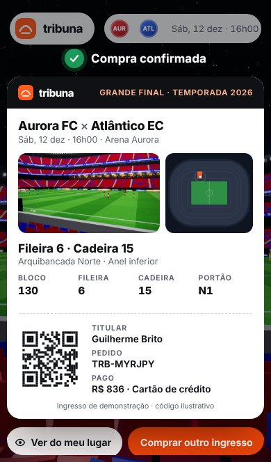
</p>

## Roadmap

- [x] **Etapa 1 · Estádio e vista aérea:** geometria, entorno, iluminação noturna, trânsito, abertura e interface base
- [x] **Etapa 2 · Setores e cadeiras:** blocos destacados ao passar o mouse, câmera descendo até o setor escolhido e vista de frente para o bloco, com cadeiras livres e ocupadas
- [x] **Etapa 3 · Ingresso e POV:** zoom na cadeira, cartão do ingresso com a prévia da vista, oferta de camarote, visão em primeira pessoa, pagamento e ingresso

## Rodando localmente

Precisa do Node 20.19+ ou 22.12+.

```bash
npm install
npm run dev
```

Para gerar a versão de produção: `npm run build` (o resultado fica em `dist/`). A cada push na `main`, o GitHub Actions gera o site e publica no GitHub Pages (ver `.github/workflows/deploy.yml`).

Parâmetros úteis na URL:

- `?intro=0` pula a abertura
- `?q=low`, `?q=medium` ou `?q=high` força um nível de qualidade
- `?cam=x,y,z,alvoX,alvoY,alvoZ` (só em desenvolvimento) libera uma câmera livre para inspecionar a cena

## Stack

React 19, TypeScript e Vite. A cena usa Three.js com React Three Fiber e drei, os efeitos vêm do postprocessing (N8AO, bloom, tone mapping), as animações de câmera são feitas com GSAP e o estado fica no Zustand.

## Como a cena é montada

**Contorno paralelo.** A primeira fileira é um retângulo de cantos arredondados, e cada fileira seguinte é a curva paralela a uma distância `d`. Com isso as retas e os cantos ficam sempre alinhados, e qualquer parte do estádio (degraus, camarotes, cobertura, fachada) vira um perfil 2D `(d, y)` varrido em volta do campo. Ver `src/lib/bowl.ts` e `src/lib/sweep.ts`.

**Blocos e cadeiras.** Cada anel é dividido em blocos separados por escadas. As cadeiras são posicionadas fileira por fileira dentro de cada bloco e desenhadas com um único `InstancedMesh`. A numeração segue o sentido horário, e o bloco central da arquibancada norte é sempre o x32 (132, 232, 332). Ver `src/lib/layout.ts`.

**Gramado.** As linhas do campo são funções de distância calculadas no fragment shader, com antisserrilhado por `fwidth`. Assim ficam nítidas tanto na vista aérea quanto rente ao chão. Ver `src/scene/stadium/pitchShader.ts`.

**Luz de jogo noturno.** Oito refletores mirando o campo, mais uma luz rebatida aplicada só aos materiais do estádio, para as arquibancadas não ficarem escuras sem clarear a cidade. As faixas de LED usam um único material emissivo animado pelo tempo. Ver `src/scene/stadium/Floodlights.tsx` e `src/scene/stadium/neon.ts`.

**Cidade.** O entorno inteiro é gerado a partir de regras (`src/lib/city/layout.ts`): avenida, via de acesso, grade de ruas que só começa depois da faixa verde, prédios de frente para as ruas, postes e árvores. As janelas acesas saem de um shader nos próprios prédios, sem textura. A luz dos postes é desenhada uma vez num mapa de luz do chão, e carros, árvores e fachadas leem esse mesmo mapa para ficarem iluminados quando estão perto de um poste.

**Trânsito.** Cada rota vira uma trajetória cronometrada, com aceleração, frenagem, redução nas curvas e paradas (uma vaga, uma ré). Os carros só leem essa tabela com uma defasagem de tempo, então não há simulação a cada quadro. Ver `src/lib/city/traffic.ts`.

**Pedestres.** Os caminhos (voltas pela esplanada, portões, pátio, calçadas) ficam guardados numa textura. Cada pessoa tem só um caminho, uma velocidade e uma defasagem, e o vertex shader calcula posição, rumo e o balanço do passo. No processador, apenas um relógio é atualizado por quadro. Ver `src/lib/city/crowd.ts` e `src/scene/city/Crowd.tsx`.

**Escolha de blocos e cadeiras.** O cursor não é testado contra a arquibancada de verdade (dezenas de milhares de triângulos), e sim contra uma superfície invisível com uma rampa por bloco, de poucas centenas de triângulos. Na vista de frente, cada cadeira do bloco vira um retângulo invisível. O destaque não troca materiais: o bloco e a cadeira em destaque são números lidos pelos shaders da arquibancada e das cadeiras, que pintam de laranja o que tiver o mesmo número (ver `src/scene/selection.ts` e `src/scene/picking/`).

**Cadeiras de perto.** Todas as cadeiras existem numa versão leve (quatro triângulos). Depois que um setor é escolhido, o bloco dele e os vizinhos do mesmo anel passam para a versão detalhada, de cerca de 200 triângulos, quando estão enquadrados e grandes o bastante na tela, dentro de um orçamento de cadeiras que depende do nível de qualidade. Um mapa de um pixel por bloco diz à versão leve quais cadeiras esconder. Ver `src/scene/stadium/Seats.tsx`.

**Painéis de LED.** A faixa na frente de cada anel é uma tira em volta do estádio inteiro, dividida por bloco. O u da textura é o comprimento percorrido em volta do estádio, e o conteúdo (um canvas com o endereço do GitHub) se repete um número inteiro de vezes, então a volta fecha sem emenda. O shader rola o texto e acende em laranja o trecho na frente do bloco em destaque. Ver `src/scene/stadium/LedRibbons.tsx`.

**Camarotes.** As laterais com camarotes são retas ao longo de x, então o número do camarote de cada pixel sai direto da posição no mundo. Com isso uma luz quente própria ilumina só o interior, e o camarote sob o cursor ou aberto fica mais claro sem nenhum material extra. Ver `src/scene/stadium/Skyboxes.tsx` e `src/lib/skyboxes.ts`.

**Telões.** Cada tela (placar, escolha da pessoa, boas-vindas e o GitHub) é desenhada uma vez num canvas próprio, que vira a textura dos dois telões; trocar de tela só troca a textura. Ver `src/scene/stadium/Screens.tsx`.

**Rede do gol.** Os fios da rede são calculados no shader, com antisserrilhado. Quando ficam mais finos que um pixel, viram a cobertura média deles, um véu branco: com uma textura recortada, a rede sumia de longe. Ver `src/scene/stadium/Pitch.tsx`.

**Vista do lugar.** A câmera sai da pose em órbita e passa a ser uma câmera em primeira pessoa: posição, rumo e inclinação do olhar. Ela desce até os olhos de quem senta na cadeira (1,2 m acima do piso) enquanto gira para o meio do campo, e a abertura vertical se ajusta à tela, para a vista não ficar estreita no celular em pé. Arrastar soma um giro limitado ao olhar, como quem vira a cabeça. Logo que a câmera chega, a imagem da tela é copiada num canvas pequeno, no mesmo quadro em que foi desenhada (depois do pós-processamento), e vira a foto do cartão e do ingresso. Ver `src/scene/CameraRig.tsx` e `src/scene/PovSnapshot.tsx`.

**Pagamento e ingresso.** O pagamento é uma demonstração: não há campos de cartão e nada sai do navegador. O ingresso junta a foto da vista, um mapa do estádio em SVG desenhado com as mesmas curvas do contorno (o bloco e a cadeira, ou o camarote, marcados) e um código 2D ilustrativo gerado a partir do número do pedido. Ver `src/ui/TicketPanel.tsx` e `src/ui/ticketParts.tsx`.

**Câmera.** Cada etapa é uma pose em coordenadas de órbita (ângulo, elevação, distância e alvo), calculada para o bloco escolhido e para a proporção da tela. O GSAP interpola entre as poses girando pelo lado mais curto, e o plano de corte próximo acompanha a distância. No celular em pé, a imagem é deslocada para cima (`setViewOffset`), para o bloco ficar no espaço acima do painel sem mudar o ângulo da câmera. Ver `src/scene/cameraPoses.ts` e `src/scene/CameraRig.tsx`.

**Desempenho.**
- Cadeiras, carros, pessoas, árvores, casas e postes são instanciados, e a cena fica em torno de 500 mil triângulos por quadro na visão geral.
- As malhas grandes do estádio (arquibancadas, cadeiras leves, poltronas e pessoas dos camarotes) são divididas por lado: de dentro do estádio a câmera enquadra um lado só, e a placa de vídeo descarta o resto. Na vista do setor isso tirou mais de 40% dos triângulos.
- De longe, as cadeiras detalhadas perdem as costas da concha e as poltronas dos camarotes perdem os cantos arredondados (partes que não aparecem com poucos pixels); as pessoas em volta do estádio não têm as faces que nunca ficam à vista.
- Os refletores e o clarão dos fogos são calculados dentro dos materiais que recebem essa luz, então a cena só tem duas luzes reais (luar e ambiente) e nenhum mapa de sombra.
- Nas vistas de dentro do estádio (setor, bloco e camarote), enquanto a câmera desce, tudo o que fica fora do estádio se apaga numa neblina que depende da distância até o centro do estádio (calculada em cada pixel, ver `src/scene/outsideFog.ts`). Com o entorno coberto, a cidade, o estacionamento, o trânsito, as pessoas na esplanada e a fachada deixam de ser desenhados e animados (ver `src/scene/outside.ts`).
- Os shaders são compilados em paralelo antes do primeiro quadro (`compileAsync`). Depois, a cena inteira é desenhada uma vez num alvo de 1×1 pixel, só para enviar geometrias e texturas à placa de vídeo. Esse envio espera o título da abertura terminar de aparecer, para não travar a animação.
- As cadeiras 3D só aparecem de perto. De longe, o degrau mostra a cor de cada cadeira, lida de um mapa filtrado pela placa de vídeo (uma linha por fileira); 60 mil triângulos de um pixel eram a parte mais cara da vista aérea.
- As superfícies foscas (chão, arquibancadas, cobertura, prédios, árvores) usam um material só de luz difusa, mais barato que o de reflexos.
- A abertura de texto fica no `index.html` e só anima opacity e transform, então roda no compositor do navegador, fora da thread principal, enquanto o JavaScript monta a cena (ver `src/ui/bootSequence.ts`). Desfoque (`filter: blur`) não pode ser usado nessas animações, porque obriga a animação a voltar para a thread principal.
- Nada de importante fica menor que um ou dois pixels, para não piscar com pouco antisserrilhado: as luzes pequenas (postes, refletores, faróis) são sprites com tamanho mínimo e brilho que conserva energia, as pessoas crescem um pouco quando estão longe, e as cadeiras e os carros parados ocupam a célula ou a vaga inteira e misturam a cor com a dos vizinhos (ver `src/scene/pixelScale.ts`).
- Há três níveis de qualidade (`src/config/quality.ts`). O nível inicial depende do aparelho: baixo no celular, em placas de vídeo integradas e em máquinas fracas; médio nas demais. Depois ele sobe ou desce conforme o FPS medido, priorizando a fluidez. Cada nível define um orçamento de pixels para o canvas, o antisserrilhado, a oclusão de ambiente, o bloom, o tamanho das texturas do chão e a quantidade de pessoas. No PC a resolução nunca fica abaixo da nativa (MSAA 4x no médio e no alto, SMAA no baixo).

## Estrutura

```
src/
  config/   medidas do estádio, lua e cores da noite, dados da partida
  lib/      geometria do contorno, blocos e cadeiras, cidade e trânsito
  scene/    cena 3D: estádio, cidade, céu, câmera e pós-processamento
  store/    estado da experiência
  ui/       interface sobre o canvas
```

## Licença

MIT
