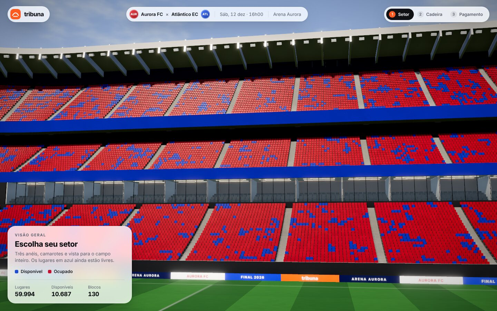

# Stadium Tickets 3D

Compra de ingressos em 3D para um estádio fictício, numa noite de final. A experiência começa com a vista aérea do estádio; você escolhe o setor, a câmera desce até a arquibancada, você escolhe a cadeira e vê o campo exatamente de onde vai assistir ao jogo.


> Projeto de estudo. O estádio (Arena Aurora), os clubes (Aurora FC e Atlântico EC), a partida e a marca de ingressos (tribuna) são inventados.

## O que já tem

- Estádio gerado em código: três anéis de arquibancada, 130 blocos, cerca de 60 mil cadeiras, 24 camarotes, cobertura com treliças e fachada com brises
- Noite de jogo: refletores na cobertura, fachada e cobertura com faixas de LED animadas, céu estrelado com lua
- Gramado feito em shader, com faixas de corte e as marcações oficiais (105 x 68 m)
- Esplanada iluminada ligada ao estacionamento, uma via de acesso a partir da avenida e a cidade em volta, separada por jardins com palmeiras e um lago
- Bairros com casas, quintais, piscinas e prédios com janelas acesas, duas vilinhas perto do complexo e um skyline ao fundo
- Trânsito: carros na avenida e nos bairros, carros entrando no estacionamento pelas portarias, estacionando, desligando o motor, dando ré e indo embora, todos com faróis, lanternas e luz de freio
- Cerca de 3 mil pessoas andando em volta do estádio, chegando pelos portões, vindo do estacionamento e passeando pelas calçadas
- Abertura com fogos de artifício sobre o estádio, que contorna o complexo e termina na vista aérea
- Tela de carregamento, dados da partida e painel de disponibilidade

| Vista aérea | Estacionamento e avenida |
| --- | --- |
|  |  |

| Torcida na esplanada | Arquibancada norte |
| --- | --- |
|  |  |

<p align="center"></p>

## Roadmap

- [x] **Etapa 1 · Estádio e vista aérea:** geometria, entorno, iluminação noturna, trânsito, abertura e interface base
- [ ] **Etapa 2 · Setores e cadeiras:** blocos destacados ao passar o mouse, câmera descendo até o setor escolhido e vista de frente para o bloco, com cadeiras livres e ocupadas
- [ ] **Etapa 3 · Ingresso e POV:** zoom na cadeira, cartão do ingresso com a prévia da vista, upgrade para camarote, visão em primeira pessoa e checkout

## Rodando localmente

Precisa do Node 20.19+ ou 22.12+.

```bash
npm install
npm run dev
```

Para gerar a versão de produção: `npm run build` (o resultado fica em `dist/`).

Parâmetros úteis na URL:

- `?intro=0` pula a abertura
- `?cam=x,y,z,alvoX,alvoY,alvoZ` (só em desenvolvimento) libera uma câmera livre para inspecionar a cena

## Stack

React 19, TypeScript e Vite. A cena usa Three.js com React Three Fiber e drei, os efeitos vêm do postprocessing (N8AO, bloom, tone mapping), as animações de câmera são feitas com GSAP e o estado fica no Zustand.

## Como a cena é montada

**Contorno paralelo.** A primeira fileira é um retângulo de cantos arredondados, e cada fileira seguinte é a curva paralela a uma distância `d`. Com isso as retas e os cantos ficam sempre alinhados, e qualquer parte do estádio (degraus, camarotes, cobertura, fachada) vira um perfil 2D `(d, y)` varrido em volta do campo. Ver `src/lib/bowl.ts` e `src/lib/sweep.ts`.

**Blocos e cadeiras.** Cada anel é dividido em blocos separados por escadas. As cadeiras são posicionadas fileira por fileira dentro de cada bloco e desenhadas com um único `InstancedMesh`. A numeração segue o sentido horário, e o bloco central da arquibancada norte é sempre o x32 (132, 232, 332). Ver `src/lib/layout.ts`.

**Gramado.** As linhas do campo são funções de distância calculadas no fragment shader, com antisserrilhado por `fwidth`. Assim ficam nítidas tanto na vista aérea quanto rente ao chão. Ver `src/scene/stadium/pitchShader.ts`.

**Luz de jogo noturno.** Oito refletores mirando o campo, mais uma luz rebatida aplicada só aos materiais do estádio, para as arquibancadas não ficarem escuras sem clarear a cidade. As faixas de LED usam um único material emissivo animado pelo tempo. Ver `src/scene/stadium/Floodlights.tsx` e `src/scene/stadium/neon.ts`.

**Cidade.** O entorno inteiro é gerado a partir de regras (`src/lib/city/layout.ts`): avenida, via de acesso, grade de ruas que só começa depois da faixa verde, prédios de frente para as ruas, postes e árvores. As janelas acesas saem de um shader nos próprios prédios, sem textura. A luz dos postes é desenhada uma vez num mapa de luz do chão, e carros, árvores e fachadas leem esse mesmo mapa para ficarem iluminados quando estão perto de um poste.

**Trânsito.** Cada rota vira uma trajetória cronometrada, com aceleração, frenagem, redução nas curvas e paradas (uma vaga, uma ré). Os carros só leem essa tabela com uma defasagem de tempo, então não há simulação a cada quadro. Ver `src/lib/city/traffic.ts`.

**Pedestres.** Os caminhos (voltas pela esplanada, portões, pátio, calçadas) ficam guardados numa textura. Cada pessoa tem só um caminho, uma velocidade e uma defasagem, e o vertex shader calcula posição, rumo e o balanço do passo. No processador, apenas um relógio é atualizado por quadro. Ver `src/lib/city/crowd.ts` e `src/scene/city/Crowd.tsx`.

**Desempenho.** Cadeiras, carros, pessoas, árvores, casas e postes são instanciados; o mapa de sombras é renderizado só nos primeiros quadros; a resolução cai sozinha quando a máquina não acompanha.

## Estrutura

```
src/
  config/   medidas do estádio, lua e cores da noite, dados da partida
  lib/      geometria do contorno, blocos e cadeiras, cidade e trânsito
  scene/    cena 3D: estádio, cidade, céu, câmera e pós-processamento
  store/    estado da experiência
  ui/       interface sobre o canvas
```

## Licença

MIT
