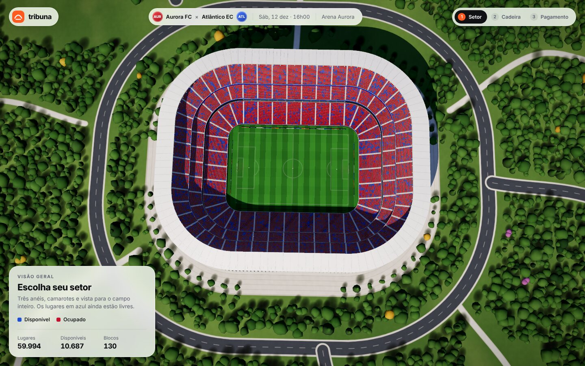

# Stadium Tickets 3D

Compra de ingressos em 3D para um estádio fictício. A experiência começa com a vista aérea do estádio; você escolhe o setor, a câmera desce até a arquibancada, você escolhe a cadeira e vê o campo exatamente de onde vai assistir ao jogo.



> Projeto de estudo. O estádio (Arena Aurora), os clubes (Aurora FC e Atlântico EC), a partida e a marca de ingressos (tribuna) são inventados.

## O que já tem

- Estádio gerado em código: três anéis de arquibancada, 130 blocos, cerca de 60 mil cadeiras, 24 camarotes, cobertura com treliças e fachada com brises
- Gramado feito em shader, com faixas de corte e as marcações oficiais (105 x 68 m)
- Parque em volta com praça, avenidas, caminhos, lago e umas 14 mil árvores
- Céu com nuvens, sombras do sol, oclusão de ambiente, bloom e tone mapping
- Abertura que contorna o estádio e termina na vista aérea
- Tela de carregamento, dados da partida e painel de disponibilidade

| Abertura | Arquibancada norte | Celular |
| --- | --- | --- |
|  |  |  |

## Roadmap

- [x] **Etapa 1 · Estádio e vista aérea:** geometria, entorno, iluminação, abertura e interface base
- [ ] **Etapa 2 · Setores e cadeiras:** blocos destacados ao passar o mouse, câmera descendo até o setor escolhido e vista de frente para o bloco, com cadeiras livres e ocupadas
- [ ] **Etapa 3 · Ingresso e POV:** zoom na cadeira, cartão do ingresso com a prévia da vista, upgrade para camarote, visão em primeira pessoa e checkout

## Rodando localmente

Precisa do Node 20.19+ ou 22.12+.

```bash
npm install
npm run dev
```

Para gerar a versão de produção: `npm run build` (o resultado fica em `dist/`).

Parâmetros úteis na URL:

- `?intro=0` pula a abertura
- `?cam=x,y,z,alvoX,alvoY,alvoZ` (só em desenvolvimento) libera uma câmera livre para inspecionar a cena

## Stack

React 19, TypeScript e Vite. A cena usa Three.js com React Three Fiber e drei, os efeitos vêm do postprocessing (N8AO, bloom, tone mapping), as animações de câmera são feitas com GSAP e o estado fica no Zustand.

## Como o estádio é montado

**Contorno paralelo.** A primeira fileira é um retângulo de cantos arredondados, e cada fileira seguinte é a curva paralela a uma distância `d`. Com isso as retas e os cantos ficam sempre alinhados, e qualquer parte do estádio (degraus, camarotes, cobertura, fachada) vira um perfil 2D `(d, y)` varrido em volta do campo. Ver `src/lib/bowl.ts` e `src/lib/sweep.ts`.

**Blocos e cadeiras.** Cada anel é dividido em blocos separados por escadas. As cadeiras são posicionadas fileira por fileira dentro de cada bloco e desenhadas com um único `InstancedMesh`. A numeração segue o sentido horário, e o bloco central da arquibancada norte é sempre o x32 (132, 232, 332). Ver `src/lib/layout.ts`.

**Gramado.** As linhas do campo são funções de distância calculadas no fragment shader, com antisserrilhado por `fwidth`. Assim ficam nítidas tanto na vista aérea quanto rente ao chão. Ver `src/scene/stadium/pitchShader.ts`.

**Sombras estáticas.** Como nada na cena se move, o mapa de sombras 4K é renderizado só nos primeiros quadros.

**Árvores.** São separadas em blocos espaciais para que o frustum culling descarte o que está fora da tela. As sombras delas no chão já vêm desenhadas na textura do parque.

## Estrutura

```
src/
  config/   medidas do estádio, posição do sol, dados da partida
  lib/      geometria do contorno, layout de blocos e cadeiras, parque
  scene/    cena 3D: estádio, parque, céu, câmera e pós-processamento
  store/    estado da experiência
  ui/       interface sobre o canvas
```

## Licença

MIT
